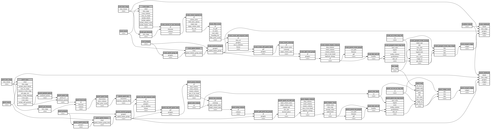

```
# AUTOGENERATED BY ECOSCOPE-WORKFLOWS; see fingerprint in README.md for details

```

```yaml
# fingerprint:
artifacts_sha256_basic: b59b8e735ae9ec1ac081f0e4e51c77c8795f62e741254a92c0cf94d530d7f273
artifacts_sha256_strict: a42bd56a22c9b2b9ef984f7850632be8a5fd1b0ea583a561f6f38d2c743b4f47
installed_requirements:
- channel: https://repo.prefix.dev/ecoscope-workflows/
  name: ecoscope-platform
  version: {version: ==2.23.0}
- channel: conda-forge
  name: pydeck
  version: {version: ==0.9.2}
params_sha256: ed4a3f0fc686ff5a4f1c13af842f1a1b6abb9d843a47b4bde3dbb7ce6e00167b
spec_sha256: 16e9410ec6c8b2937a06f56af4cd5d03846e51ccaa47b18b0afedf082258acea

```

# ecoscope-workflows-multi-source-workflow-workflow


